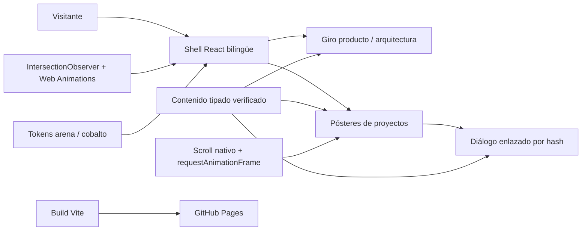

# Kevin Hernández — Portfolio

[English version](./README.md)

[](https://github.com/kevin0018/portfolio/actions/workflows/deploy.yml)

Mi portfolio full stack interactivo: productos reales presentados como pósteres
en movimiento, una portada con mi nombre dividido, un giro de producto a
arquitectura y títulos que se separan y se alinean al hacer scroll. Diseñado
con Taste Skill.

[Ver portfolio](https://kevin0018.github.io/portfolio/) ·
[Descargar CV](./public/assets/files/CV_Kevin_Hernandez_Deras.pdf)

[](https://kevin0018.github.io/portfolio/)

## Puntos destacados

- Explora cuatro productos reales en un escenario de pósteres animados con scroll.
- Gira cada captura de la portada para descubrir su frontend, la frontera de
  aplicación, el backend y las fuentes de datos verificadas.
- Abre casos bilingües de [wikiLoL](https://github.com/kevin0018/wikiLoL),
  [Blog de Viajes](https://github.com/kevin0018/Blog-de-Viajes),
  [Huellas](https://github.com/kevin0018/Huellas) y
  [PokeShop](https://github.com/kevin0018/PokeShop), con galerías de pantallas,
  imágenes a tamaño completo, decisiones técnicas, demos y repositorios.
- Consulta mi trabajo actual en Inmatic, mi formación y mis certificaciones DevOps.
- Descubre otros proyectos con un archivo visual interactivo.
- Cambia entre español e inglés con preferencia persistida. Pausa el movimiento
  desde la cabecera.
- Accede a cada caso mediante su hash. Escape cierra el diálogo y el foco vuelve
  al control que lo abrió.

## Arquitectura



El contenido está separado de la presentación en módulos TypeScript bilingües.
Los cuatro productos comparten un componente de galería y decisiones técnicas.
Las vistas de arquitectura describen la implementación real de cada producto;
no son interfaces de aplicación inventadas.

### Decisiones que merece la pena revisar

- El scroll nativo dirige dos escenas breves con elementos sticky sin interceptar
  la rueda ni los gestos táctiles.
- Las imágenes se desplazan en sentidos opuestos. La separación del título está
  acotada para mantener la acción del proyecto libre de solapamientos.
- `MotionEffects` agrupa las actualizaciones con `requestAnimationFrame` y anima
  las entradas de las partes de cada sección con Web Animations.
- Pausar el movimiento o solicitar movimiento reducido muestra los cuatro
  proyectos en el flujo normal. El estado interactivo sigue al estado visual.
- Los diálogos nativos admiten Escape, restauración del foco, hashes e historial.
- Capturas y CV respetan `BASE_URL` para el despliegue en GitHub Pages.
- `tokens.css` define la paleta de Taste Skill, las fuentes Unbounded/Onest y los
  tiempos de movimiento.
- Las propuestas generadas, críticas y capturas quedan en `.taste-skill/`, ignorado
  por Git. El sistema de diseño implementado se versiona en `design.md`.

## Stack

- **Aplicación:** React 19 y TypeScript 6
- **Build:** Vite 8
- **Interfaz:** Tailwind CSS 4 y sistema CSS propio basado en tokens
- **Contenido:** módulos tipados y bilingües de casos de estudio
- **Interacción:** scroll, anclas y diálogos nativos, `requestAnimationFrame`,
  `IntersectionObserver` y Web Animations
- **Entrega:** pnpm 11, GitHub Actions y GitHub Pages

## Estructura del proyecto

```text
portfolio/
├── .github/workflows/        # Despliegue verificado a Pages
├── docs/                     # Vista previa real del repositorio
├── public/assets/            # CV y capturas reales de proyectos
├── src/components/           # Shell y secciones narrativas reutilizables
├── src/data/                 # Casos tipados y bilingües
├── design.md                 # Sistema visual e interacciones implementadas
├── tokens.css                # Tokens de diseño portables
├── package.json
└── vite.config.ts
```

La aplicación activa utiliza los pósteres, los registros profesionales y los
casos de estudio en diálogo. Los componentes independientes anteriores se
conservan en el árbol de fuentes.

## Desarrollo local

Requisitos:

- Node.js 22.13 o posterior
- pnpm 11

```bash
git clone https://github.com/kevin0018/portfolio.git
cd portfolio
pnpm install --frozen-lockfile
pnpm dev
```

Vite sirve el proyecto con la misma ruta base que producción:

```text
http://localhost:5173/portfolio/
```

## Comandos

```bash
pnpm dev      # Inicia el servidor de desarrollo
pnpm lint     # Ejecuta ESLint
pnpm build    # Comprueba tipos y genera producción
pnpm preview  # Previsualiza la salida de producción
pnpm deploy   # Fallback manual con gh-pages
```

## Despliegue

Cada push a `master` instala el lockfile congelado, ejecuta lint y build, y
publica `dist/` mediante GitHub Pages. El workflow también puede iniciarse
manualmente desde GitHub Actions.

El repositorio debe usar **GitHub Actions** como origen de Pages. El comando
manual `pnpm deploy` permanece como fallback de compatibilidad.

## Atribución

La vista previa contiene capturas de proyectos que he desarrollado. Las
imágenes de League of Legends que aparecen dentro de wikiLoL pertenecen a Riot
Games. wikiLoL es un proyecto educativo no comercial y no está afiliado,
respaldado ni patrocinado por Riot Games.

Huellas es un proyecto con Adriana Elias, Aroa Granja y Fernanda Montalvan. Mi
aportación abarca arquitectura, pruebas, backend y modernización posterior. El
diseño y branding originales son de Aroa. Se enlazan la [demo de Huellas](https://huellas-frontend.vercel.app/) y el vídeo del proyecto.

PokeShop es una demo educativa independiente con precios y stock ficticios,
sin pagos ni pedidos reales. Los nombres e ilustraciones de Pokémon pertenecen
a sus titulares; los datos y recursos proceden de PokéAPI.
