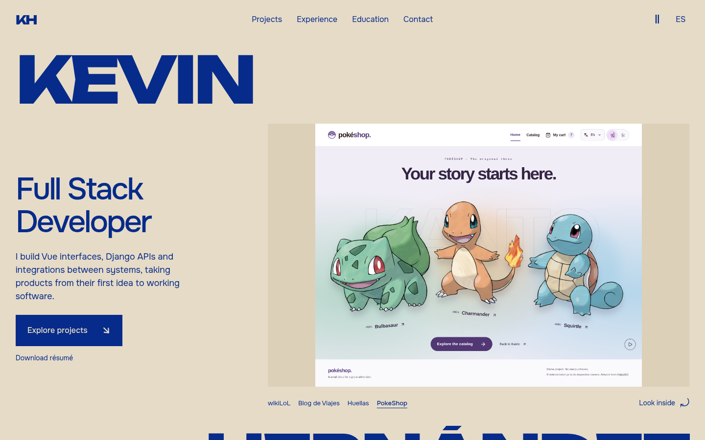
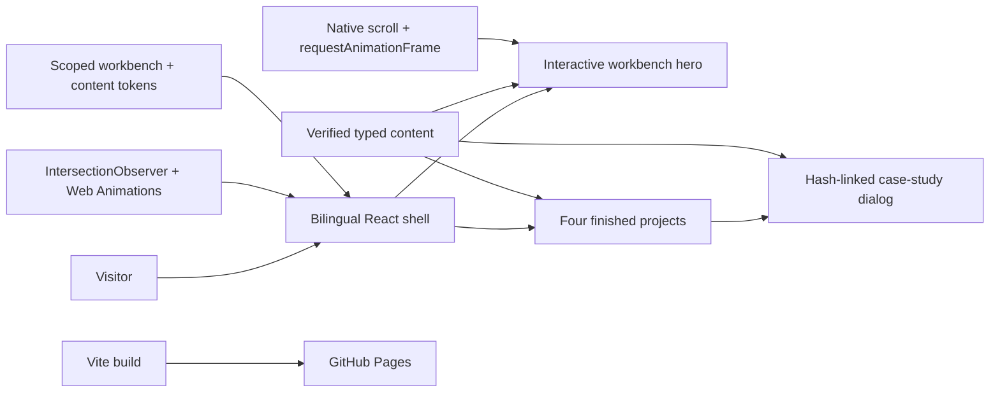

# Kevin Hernández — Portfolio

[Versión en español](./README.es.md)

[](https://github.com/kevin0018/portfolio/actions/workflows/deploy.yml)

My interactive full-stack portfolio, featuring four finished projects with
a paper workbench hero, real interface previews and animated case studies.
The opening uses a fixed navigation rail, overlapping product windows, yellow
marker accents, Onest typography and handwritten Caveat annotations.

[Live portfolio](https://kevin0018.github.io/portfolio/) ·
[Download résumé](./public/assets/files/CV_Kevin_Hernandez_Deras.pdf)

[](https://kevin0018.github.io/portfolio/)

## Highlights

- Explore four finished products with complete interface previews and readable
  project summaries.
- The hero shows real wikiLoL and Blog de Viajes interfaces as independently
  floating browser windows. Pointer movement tilts them; each opens its actual
  case study. A green arrow and “Keep exploring” link lead to projects.
- Open bilingual case studies for [wikiLoL](https://github.com/kevin0018/wikiLoL),
  [Blog de Viajes](https://github.com/kevin0018/Blog-de-Viajes),
  [Huellas](https://github.com/kevin0018/Huellas) and
  [PokeShop](https://github.com/kevin0018/PokeShop), with named screenshot galleries,
  full-size images, technical decisions, live demos and source repositories.
- Read my current responsibilities at Inmatic, education and DevOps certifications.
- Switch English/Spanish and light/dark themes with persisted preferences.
  The theme follows the system on the first visit and is applied before React
  renders. Pause motion from the navigation.
- Open case studies directly through their URL hashes; Escape closes the dialog
  and focus returns to the opening control.

## Architecture



Content stays separate from presentation in bilingual TypeScript modules. The
four featured products share one modal gallery and engineering detail component.
The opening workbench uses HTML/CSS browser frames around real product captures.
Its backing sheets, marker and doodles are CSS and SVG elements, separate from
the readable page copy and navigation. No concept image is shipped as a screen.
The hero has no carousel. The project section features wikiLoL beside its
description, with Blog de Viajes, Huellas and PokeShop in a supporting gallery.
Each real screenshot opens the corresponding case study.

### Decisions worth reviewing

- Hero and project sections follow the document flow. Text and screenshots have
  separate layout tracks, without scroll-controlled visibility or split titles.
- Complete captures preserve their proportions; the image, summary and action
  remain available together at every screen size.
- `MotionEffects` schedules scroll updates through `requestAnimationFrame` and
  gives section parts independent Web Animations entrances.
- All four projects are always in document flow. Pausing motion stops decorative
  movement without changing the layout or which projects can be reached.
- Native dialogs support Escape, focus restoration, direct hash links and history.
- Screenshots and résumé links respect Vite's `BASE_URL` for GitHub Pages.
- `workbench.css` scopes the light hero palette and responsive navigation;
  `tokens.css` defines matching light/dark palettes for the full page.
- `projectScenes.ts` maps the four real product screenshots to their lighting.
- The chosen visual reference takes priority over Taste Skill’s default style
  prohibitions; the paper ground, marker highlight and hand-drawn accents
  follow the selected third concept.
- Generated Taste direction sheets, critiques and captures stay in ignored
  `.taste-skill/`; the implemented design system stays in versioned `design.md`.

## Stack

- **Application:** React 19 and TypeScript 6
- **Build:** Vite 8
- **Interface:** Tailwind CSS 4 plus a custom token-driven CSS system
- **Content:** typed bilingual case-study modules
- **Interaction:** native scroll, anchors, dialogs, `requestAnimationFrame`,
  `IntersectionObserver` and Web Animations
- **Delivery:** pnpm 11, GitHub Actions, and GitHub Pages

## Project structure

```text
portfolio/
├── .github/workflows/        # Verified Pages deployment
├── docs/                     # Real repository preview
├── public/assets/            # CV and real project captures
├── src/components/           # Shell and reusable story sections
├── src/data/                 # Typed bilingual case studies
├── design.md                 # Implemented visual system and interactions
├── tokens.css                # Portable design tokens
├── package.json
└── vite.config.ts
```

The active shell shows only wikiLoL, Blog de Viajes, Huellas and PokeShop.
Earlier project data and standalone components are retained for future work,
but unfinished projects are not rendered or promoted in the portfolio.

## Local development

Requirements:

- Node.js 22.13 or newer
- pnpm 11

```bash
git clone https://github.com/kevin0018/portfolio.git
cd portfolio
pnpm install --frozen-lockfile
pnpm dev
```

Vite serves the project with the same base path used in production:

```text
http://localhost:5173/portfolio/
```

## Commands

```bash
pnpm dev      # Start the development server
pnpm lint     # Run ESLint
pnpm build    # Typecheck and create the production build
pnpm preview  # Preview the production output
pnpm deploy   # Manual gh-pages fallback
```

## Deployment

Every push to `master` installs the frozen pnpm lockfile, runs lint and the
production build, then publishes `dist/` through GitHub Pages. The workflow can
also be started manually from GitHub Actions.

The repository must use **GitHub Actions** as its Pages source. The manual
`pnpm deploy` command remains available as a compatibility fallback.

## Attribution

The portfolio preview contains captures from personal and team projects. Huellas
was built with Adriana Elias, Aroa Granja, and Fernanda Montalvan. My contribution
covers architecture, testing, backend, and subsequent modernization; Aroa created
the original design and branding. Huellas links to its [live demo](https://huellas-frontend.vercel.app/) and recorded tour. League of
Legends imagery shown inside the wikiLoL capture belongs to Riot Games. wikiLoL
is a non-commercial educational project and is not affiliated with, endorsed
by, or sponsored by Riot Games.

PokeShop is an independent educational demo with fictional prices and stock,
without payments or real orders. Pokémon names and artwork belong to their
rights holders; data and assets come from PokéAPI.
